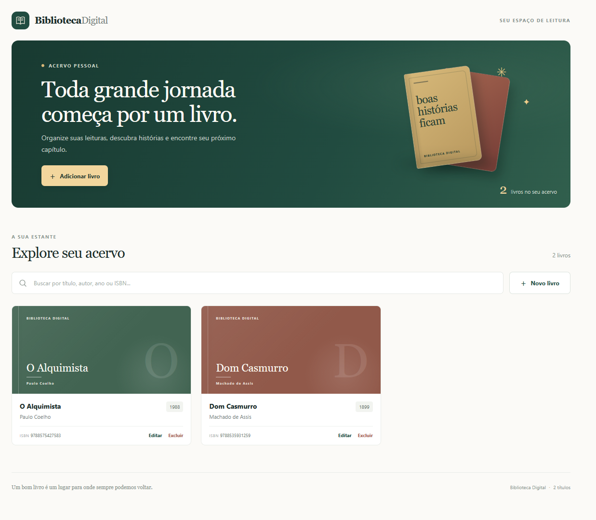
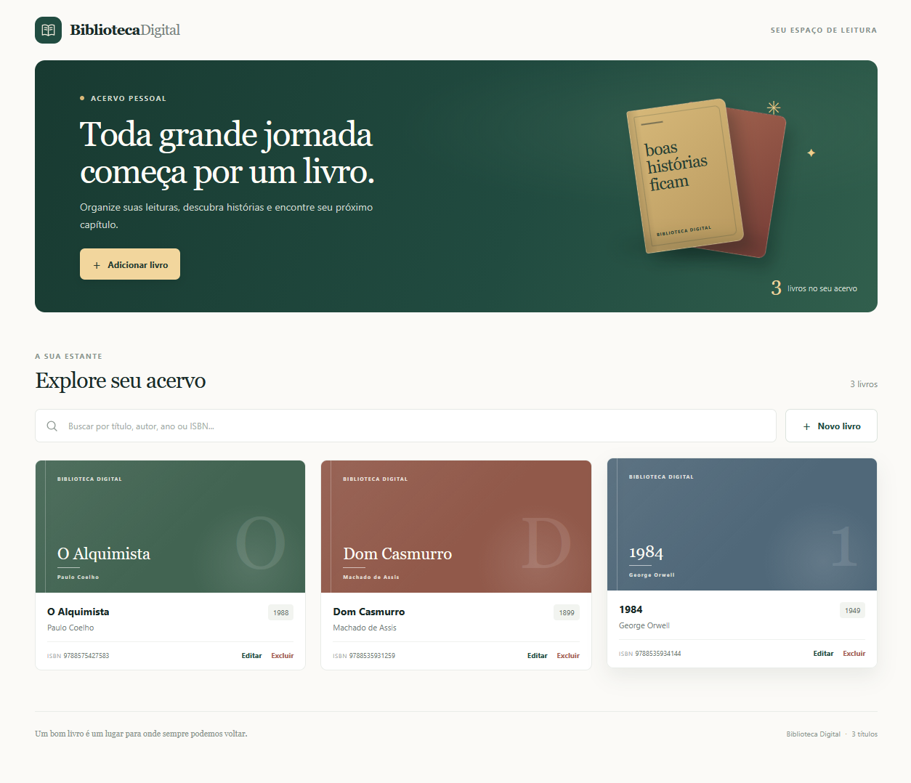
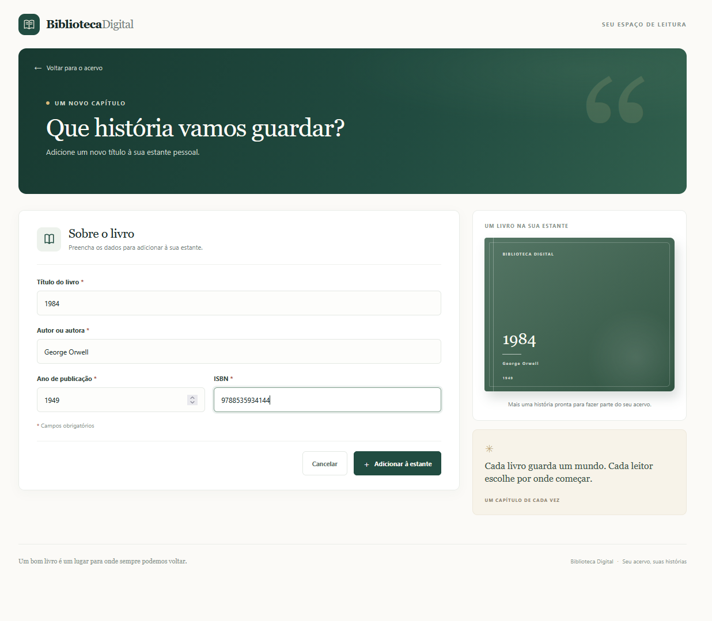
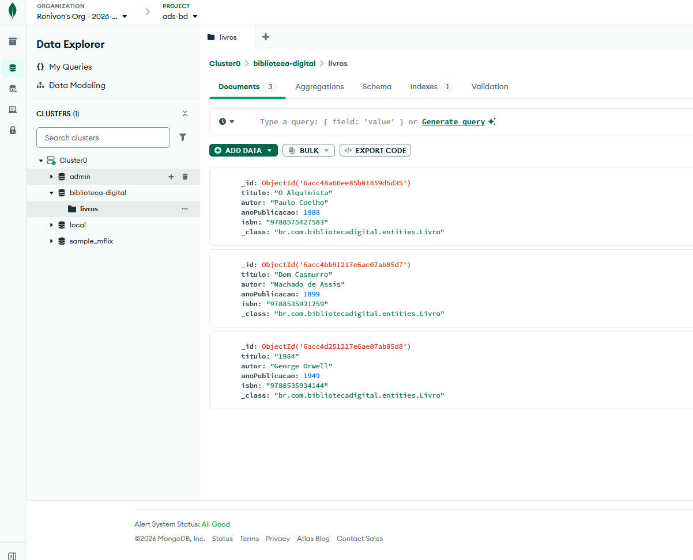

# Biblioteca Digital

Aplicação web para gestão de livros, desenvolvida em Angular no frontend e em Java com Spring Boot no backend. A ideia principal é permitir que o usuário visualize, cadastre, edite e exclua livros em uma interface simples, com os dados armazenados em MongoDB Atlas.

## Como o projeto funciona

O fluxo da aplicação é o seguinte:

1. O usuário acessa a interface em Angular.
2. A tela de livros consome a API REST do backend.
3. O backend Spring Boot recebe as requisições HTTP e executa a lógica de negócio.
4. Os dados são persistidos no MongoDB Atlas.
5. A resposta volta para o frontend e a interface é atualizada.

Em resumo:

- Frontend: Angular
- Backend: Java + Spring Boot
- Banco: MongoDB
- Comunicação: REST API

## Funcionalidades

A aplicação permite realizar as operações básicas de um catálogo de livros:

- Listar todos os livros
- Buscar livro por ID
- Cadastrar novo livro
- Atualizar informações do livro
- Excluir livro

## Tecnologias utilizadas

### Frontend

- Angular 22.1.7
- TypeScript
- HTML
- CSS
- Angular Router

### Backend

- Java 21
- Spring Boot 4.1.1
- Maven
- Spring Web MVC
- Spring Data MongoDB

### Banco de dados

- MongoDB Atlas

## Estrutura do projeto

```text
biblioteca-digital/
├── README.md
├── backend/
│   └── biblioteca-digital-api/
│       └── src/
│           ├── main/java/
│           └── test/java/
├── frontend/
│   └── biblioteca-digital/
│       ├── src/
│       ├── package.json
│       └── angular.json
├── mongo/
│   └── consultas.js
└── docs/
    └── images/
```

## Fluxo de execução do sistema

### 1) Configurar o MongoDB Atlas

Antes de iniciar a API, crie um cluster no MongoDB Atlas e obtenha a URI de conexão.

No PowerShell, configure a variável de ambiente com sua string de conexão:

```powershell
$env:MONGODB_URI = 'mongodb+srv://<usuario>:<senha>@<cluster>.mongodb.net/biblioteca-digital?retryWrites=true&w=majority'
```

Dicas:

- Use o banco de dados desejado na URI.
- Autorize o IP da máquina em `Network Access` no Atlas.
- Não compartilhe a URI no GitHub, pois ela contém credenciais.
- A API utiliza as coleções `livros` e `autores`.

### 2) Executar a API backend

Na raiz do projeto:

```powershell
cd "backend\biblioteca-digital-api"
.\mvnw spring-boot:run
```

A API ficará disponível em:

```text
http://localhost:8080
```

### 3) Executar o frontend

Em outro terminal:

```powershell
cd "frontend\biblioteca-digital"
npm install
npm start
```

O Angular iniciará a aplicação em:

```text
http://localhost:4200
```

## Endpoints da API

A API REST expõe os endpoints relacionados a livros:

- `GET /livros` → lista todos os livros
- `GET /livros/{id}` → busca um livro por ID
- `POST /livros` → cadastra um novo livro
- `PUT /livros/{id}` → atualiza um livro
- `DELETE /livros/{id}` → remove um livro

Esses endpoints são consumidos pela interface Angular, permitindo o gerenciamento completo do catálogo.

## Como a aplicação se comunica

A interface Angular envia requisições HTTP para a API Spring Boot. A API, por sua vez, acessa o MongoDB e devolve os dados para a tela.

A comunicação segue o padrão:

```text
Angular -> API REST -> MongoDB
```

## Entrega NoSQL (MongoDB)

A entrega NoSQL utiliza as entidades `Livro` e `Autor` e contém exemplos de consultas para execução no MongoDB Atlas.

O arquivo [`mongo/consultas.js`](mongo/consultas.js) reúne consultas com operações como:

- `insertOne`
- `insertMany`
- `find`
- `updateOne`
- `deleteOne`
- operadores como `$eq`, `$ne`, `$gt`, `$gte`, `$lt`, `$lte`, `$in`, `$nin`, `$or`, `$and` e `$exists`

### Executar as consultas MongoDB

Com o MongoDB Shell (`mongosh`) instalado e a variável `MONGODB_URI` já configurada:

```powershell
mongosh $env:MONGODB_URI ".\mongo\consultas.js"
```

## Screenshots

### Antes e depois: adicionar livro

<div align="center">
  <table>
    <tr>
      <td align="center">
        
        <br>
        <sub>Antes: dois livros no acervo</sub>
      </td>
      <td align="center">
        
        <br>
        <sub>Depois: livro 1984 adicionado ao acervo</sub>
      </td>
    </tr>
  </table>
</div>

### Cadastro de livro

<div align="center">
  
</div>

### Dados no MongoDB Atlas

<div align="center">
  
</div>

## Observações finais

Este projeto foi desenvolvido como uma aplicação de gerenciamento de acervo bibliográfico e serve como exemplo de integração entre:

- frontend moderno em Angular
- backend em Java com Spring Boot
- banco NoSQL em MongoDB
- comunicação via API REST